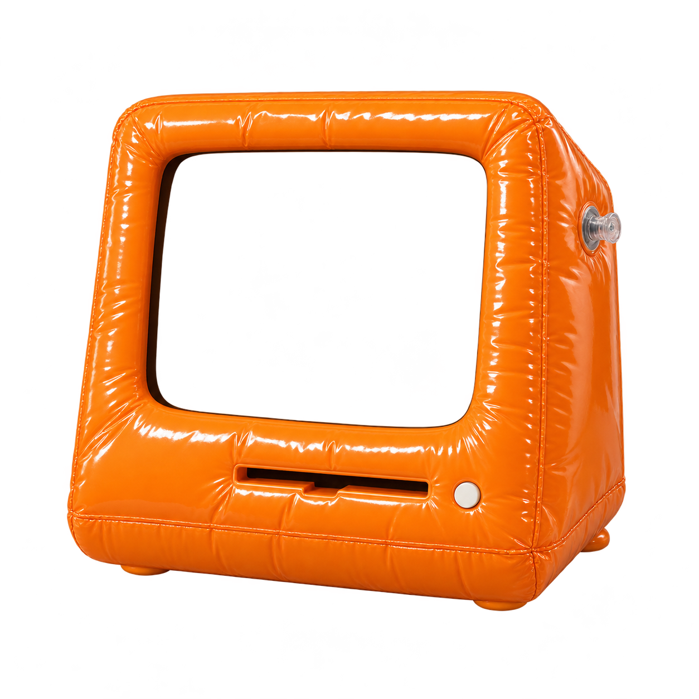
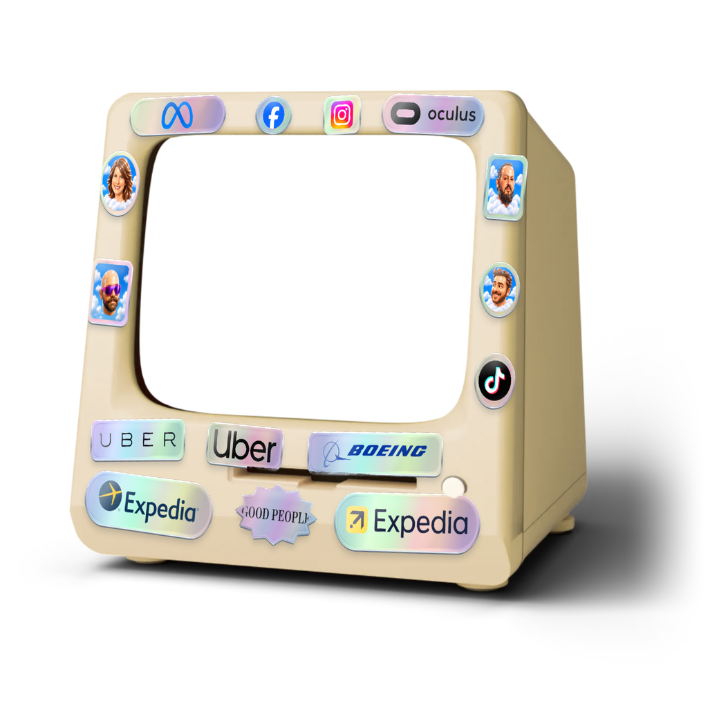
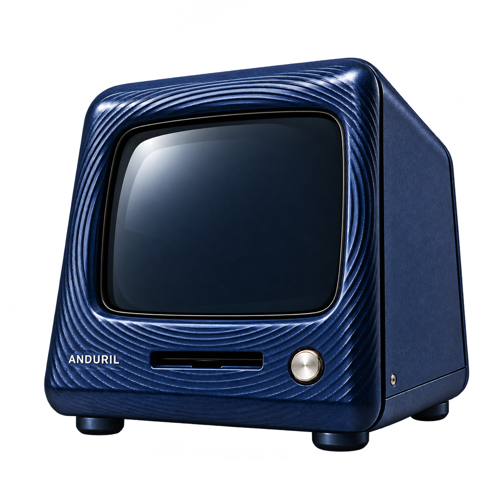
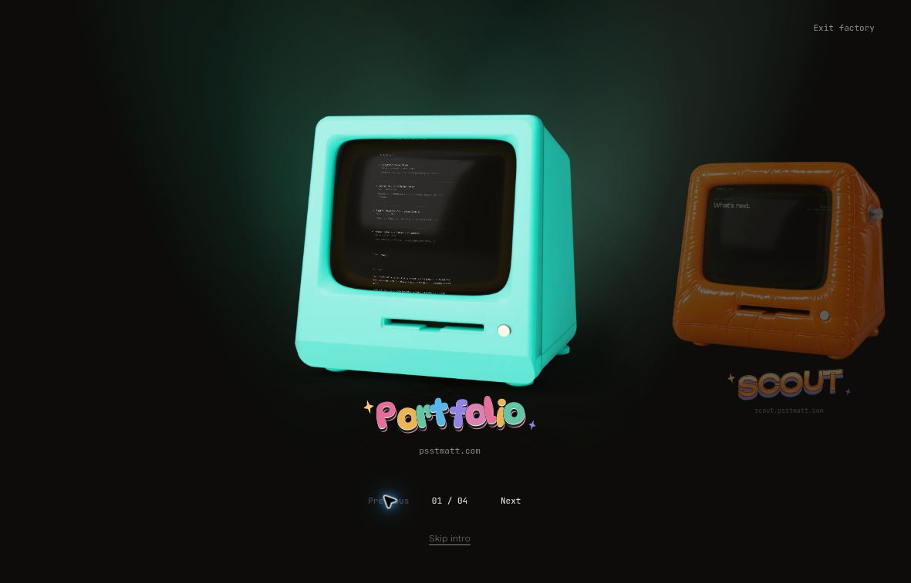
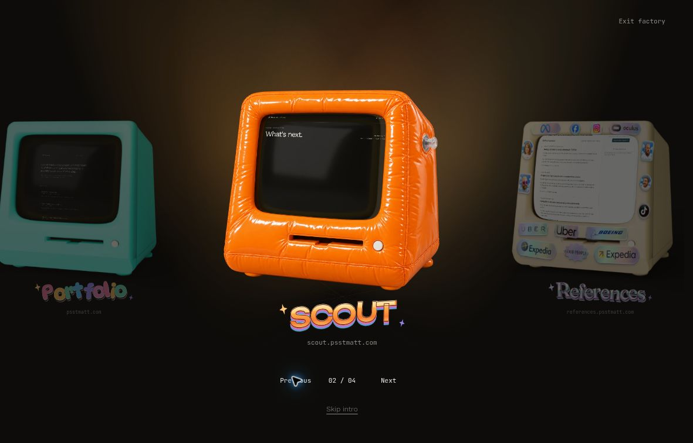
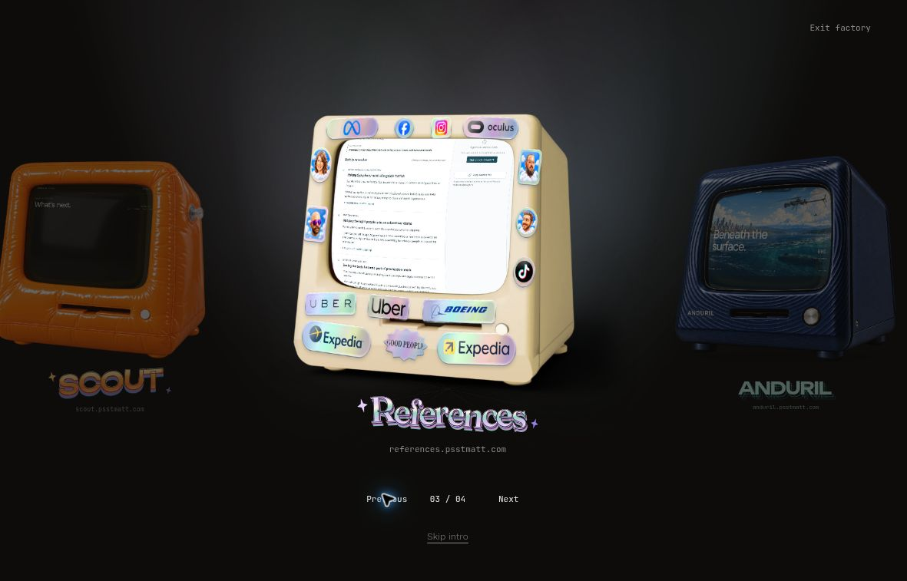
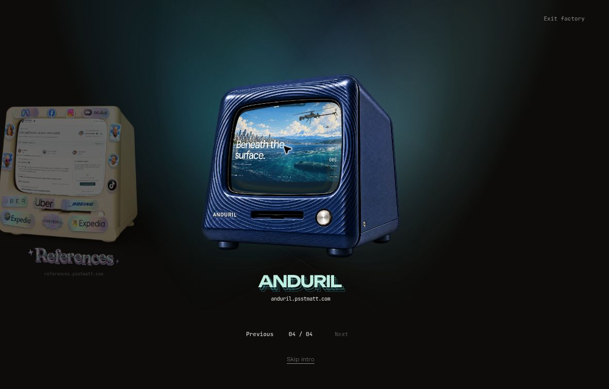

# Mattsoft

Matt Reynolds's text-first portfolio, with a secret room full of computers.

[Live portfolio](https://psstmatt.com/) · [Computer prototype](https://matt-konami-computers.psstmatt.chatgpt.site/) · [Development](#development)

## Find the computers

The homepage starts with the original green Portfolio computer. Click or tap its screen to enter, or use Tab and Enter. **Skip intro** opens the portfolio directly.

To unlock the other computers, enter the Konami code while the entrance is open:

- **Keyboard:** ↑ ↑ ↓ ↓ ← → ← → B A
- **Phone or tablet:** swipe ↑ ↑ ↓ ↓ ← → ← → on the computer. The touch sequence is eight directional swipes, with no B or A.

Once unlocked, use the previous/next buttons, left/right arrow keys, or horizontal swipes to choose a machine. Click or tap its screen to enter its site.

## Meet the machines

All four machines below are shipped on [psstmatt.com](https://psstmatt.com/). The production baseline for this guide is [commit 18c588b](https://github.com/psstmatt/mattsoft/commit/18c588b5c22fc8546e40675528d522d2eccc78a4).

| Computer            | Look                                   | Destination                                                 | Shipped entry and keyboard focus                                                                         |
| ------------------- | -------------------------------------- | ----------------------------------------------------------- | -------------------------------------------------------------------------------------------------------- |
| **Portfolio**       | Original green desktop                 | [psstmatt.com](https://psstmatt.com/)                       | The camera enters the CRT and reveals the portfolio. Stage focus.                                        |
| **Scout**           | Orange inflatable vinyl                | [scout.psstmatt.com](https://scout.psstmatt.com/)           | The case inflates before the camera passes through the screen. Halo focus.                               |
| **References**      | Puffy stickers and chrome foil         | [references.psstmatt.com](https://references.psstmatt.com/) | The case tilts as stickers orbit around the opening page. Spotlight focus.                               |
| **Anduril / Sonar** | Upright navy case with sculpted ridges | [anduril.psstmatt.com](https://anduril.psstmatt.com/)       | A quiet approach through the curved screen into Descent. Tidal Field selection/focus and Echo lettering. |

### The case art

|                                                         Scout                                                         |                                                                    References                                                                    |                                                         Anduril / Sonar                                                          |
| :-------------------------------------------------------------------------------------------------------------------: | :----------------------------------------------------------------------------------------------------------------------------------------------: | :------------------------------------------------------------------------------------------------------------------------------: |
|  |  |  |

These are the unchanged case assets used in production, shown without the runtime page previews and effects. They are artwork, not screenshots of a working screen. Image sources and capture notes are in [the image guide](docs/computers/README.md).

### Motion, screens, and sound

- Portfolio keeps its original green material and screen-entry transition. The rainbow remains visible for four seconds after entry, then fades.
- Scout and References use their approved “Absurd” entry animations. Sonar uses its own curved screen mesh for both the idle preview and entry, keeping the page fitted to the CRT aperture.
- External computers show captured previews of their destinations. After entry, the browser opens the actual site; its loading behavior belongs to that destination.
- Captions use the machine names without number eyebrows. The navigation still shows the position count.
- Keyboard focus belongs to the active machine and clears during pointer selection and entry. Reduced motion uses static focus cues and immediate entry. Forced-colors mode keeps a visible caption focus cue.
- In production, Escape skips the entrance to Portfolio. During an external machine's entry animation, Escape cancels that entry and returns to the deck. Direct project links retain normal navigation.

Sound is on by default, using the original retro cues. A silent AudioContext is prepared before screen-on; the boot chime plays only if the browser allows it then. A blocked boot chime is never replayed late. Konami input and activation gestures resume one shared audio context, drop stale feedback, and recover after interruptions. Browser autoplay rules and device volume still apply.

## In the prototype

**Prototype only:** [matt-konami-computers.psstmatt.chatgpt.site](https://matt-konami-computers.psstmatt.chatgpt.site/) is the public workbench. The following work is separate from the shipped production behavior above.

|                                                                               Portfolio                                                                                |                                                                                  Scout                                                                                  |
| :--------------------------------------------------------------------------------------------------------------------------------------------------------------------: | :---------------------------------------------------------------------------------------------------------------------------------------------------------------------: |
|             |                             |
|                                                                             **References**                                                                             |                                                                           **Anduril / Sonar**                                                                           |
|  |  |

Actual desktop screenshots of **public prototype v59**, captured October 11, 2026 (UTC), after returning to each machine with Escape. Factory lights and **Exit factory** are prototype-only. The green Portfolio color comes from the running renderer. [View the narrow light-theme capture and image details](docs/computers/README.md#prototype-screenshots).

### Factory navigation and lights

The v59 factory preview adds **Exit factory**, Escape-based return/cancel behavior, and a shared set of spotlights that changes color with the selected machine.

- Escape during entry cancels the transition and restores the selected computer.
- Escape from a settled destination preview returns to the computer it came from.
- **Exit factory**, or Escape from the expanded room, collapses the room to the green computer. **Show computers** reopens the earned unlock.
- Local controls and open overlays get first use of Escape. The factory preserves the earned unlock and selected machine during the visit.

The prototype's external destinations are local captures with an **Open live** link. Scout's preview contains only its public header, with no account or project data. These local previews make return navigation testable without changing the destination sites.

These factory controls and lights are prototype features. Production keeps the per-machine Stage, Halo, Spotlight, and Tidal Field treatments described above. Review controls, type selectors, replay controls, and query unlocks are excluded from production.

### Multi-angle prototype (v60)

The shipped orange Scout and navy Sonar scenes each use a single case pose. References has an existing bank of 57 case images, but the shipped selected Canvas path uses its center frame.

The [v60 prototype](https://matt-konami-computers.psstmatt.chatgpt.site/?deck=1&motion=absurd&v=60) connects References to all 57 original case views and adds **19 yaw angles × 3 pitch angles** for both Scout and Sonar. Each Scout/Sonar pose has a matched case image, glass image, and screen registration. The runtime loads the center first and nearby views on demand, with two frame loads at a time and a normal six-frame cache.

References smoothly returns to its center pose before the original sticker entry animation. Scout and Sonar keep their case, glass, and screen fitted together as the view changes.

The new Scout and Sonar views use calibrated **2.5D relief projected from the approved artwork**, over a narrow range around the original pose. Lighting remains baked into the source image. Unseen rear geometry, physical materials, and changing reflections have not been reconstructed. These angle interactions remain **prototype-only**; the v59 screenshots above predate them.

The v60 verification snapshot is 297 passing automated tests plus cloud-browser Canvas checks of pointer-driven views and Escape cancellation. Physical-device Safari and WebGL-specific behavior remain unverified.

## Easter eggs on the drawing board

The Konami unlock is already real. These five extra ideas are **planned**, with no implementation claimed in the production or prototype versions documented here.

| Idea                         | Intended interaction                                                  |
| ---------------------------- | --------------------------------------------------------------------- |
| **Sonar ping**               | Turn or click the Sonar knob for a ping, with a creature to discover. |
| **Let the air out**          | Use Scout's orange valve for a squeak and a deflate gag.              |
| **Secret under the sticker** | Rub the holographic sticker to uncover a secret.                      |
| **LAN party**                | Leave the computers idle and discover them having a little LAN party. |
| **HOTDOG technician**        | Type `HOTDOG` to summon a technician.                                 |

## Development

The project uses Bun and its committed lockfile.

```bash
bun install --frozen-lockfile
bun run dev
```

Available checks:

```bash
bun test tests
bun run typecheck
bun run lint
bun run build
bun run check
```

`bun run check` runs typecheck, lint, and build. Run `bun test tests` separately for the entrance, input, renderer, motion, sound, and telemetry tests.

The entrance lives in `src/components/portfolio-experience.tsx` and `src/components/secret-computer-deck.tsx`. Input matching is in `src/lib/konami-input.ts`; the browser renderers, screen geometry, transitions, and case assets are under `public/experience/`.

## Production safety

- Only the seven canonical HTML routes on `https://psstmatt.com` are indexable.
- Preview and generated `vercel.app` hosts, unknown routes, and server errors remain `noindex, nofollow`.
- Canonical links, Open Graph URLs, `robots.txt`, and `sitemap.xml` resolve to the apex domain.
- Vercel Web Analytics and Speed Insights are present, but their `beforeSend` guards allow telemetry only when the page URL is on the exact `psstmatt.com` host.
- Legacy hash URLs from the previous portfolio resolve to the closest surviving case study or catalog entry.

A Vercel Production artifact can be staged without assigning a domain. Production deployment, moving `psstmatt.com`, changing aliases, and changing DNS require an explicit release decision. Publishing the separate computer prototype does not ship those changes to the portfolio.

## Source provenance

- Original Lovable project: `b791c73d-1837-469e-b9f9-67d654d497b7`
- Private source backup: `psstmatt/motion-whisper-portfolio`
- Imported source commit: `50de093c6d9a3935225a7de0672c0618d905e095`
- Import method: the tracked tree at that commit was copied without its Git history.
- Visual baseline: [motion-whisper-portfolio.lovable.app](https://motion-whisper-portfolio.lovable.app)

The first commit is the untouched source snapshot. Later commits add independent development and Vercel deployment support, the computer entrance, the secret deck, and subsequent portfolio refinements. This public repository is separate from the project connected to Lovable.
