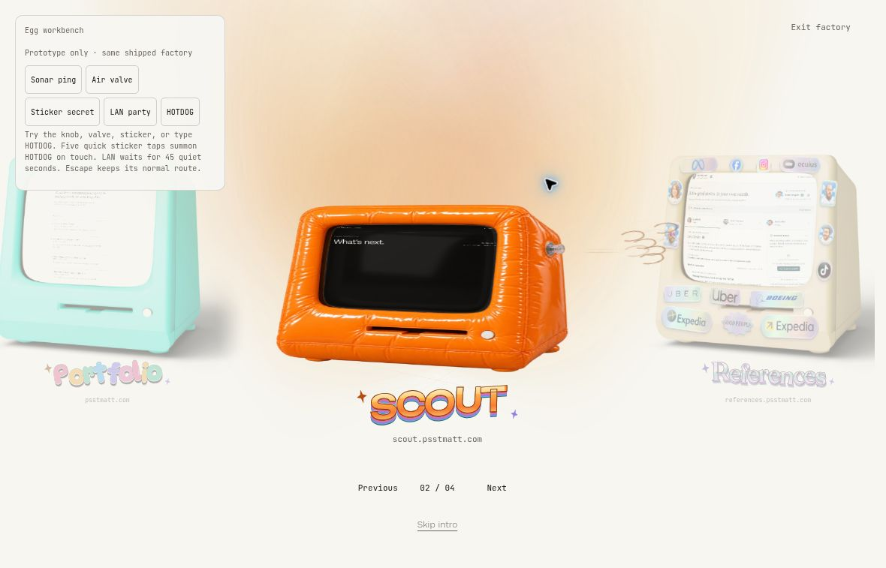
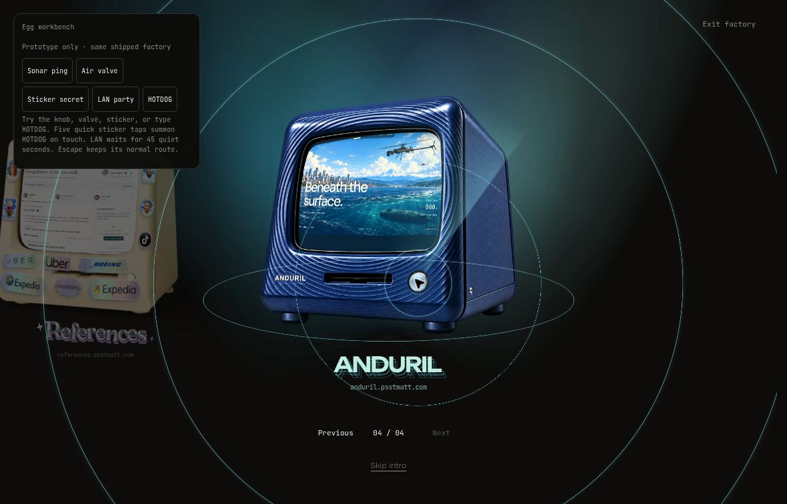
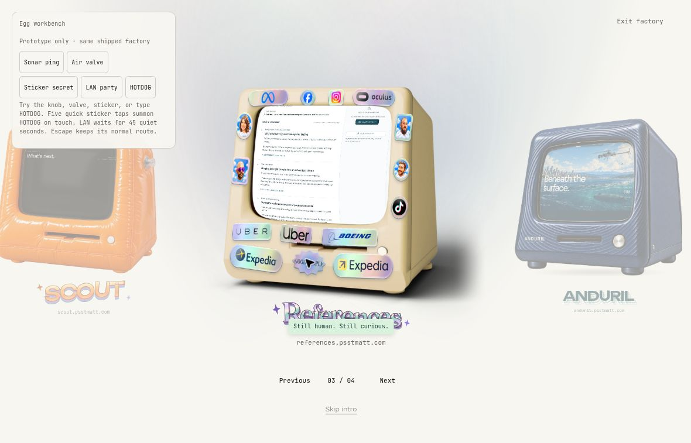
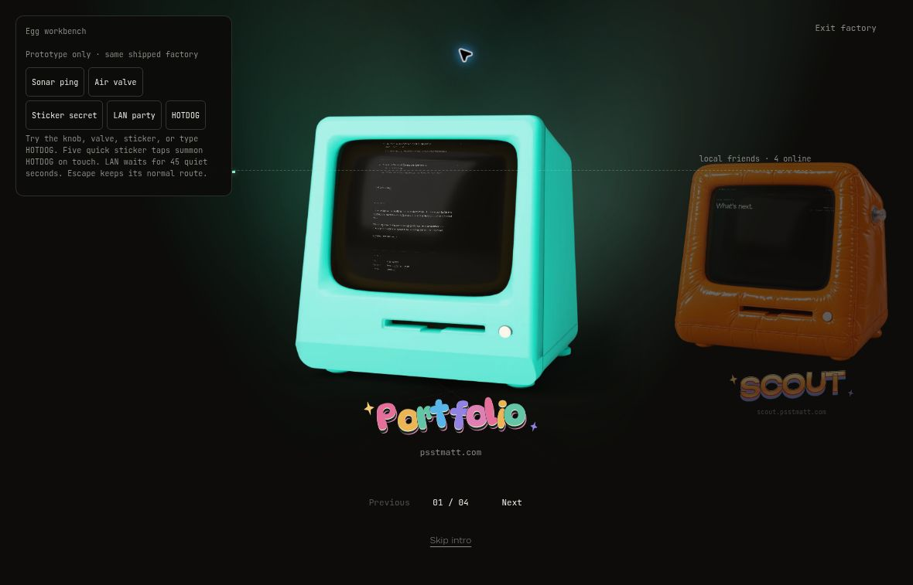
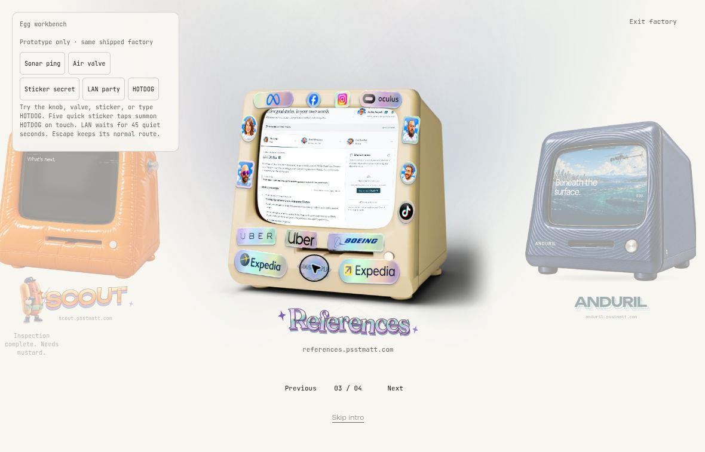
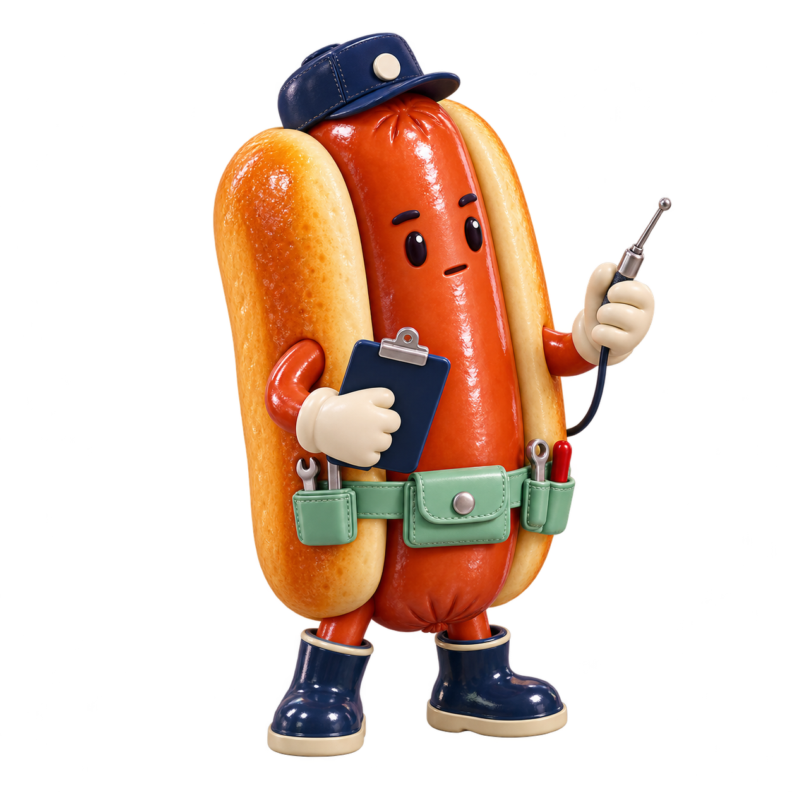

# Mattsoft

Matt Reynolds's text-first portfolio, with a secret room full of computers.

[Live portfolio](https://psstmatt.com/) · [Computer prototype](https://matt-konami-computers.psstmatt.chatgpt.site/) · [Development](#development)

## Find the computers

The homepage starts with the original green Portfolio computer. Click or tap its screen to enter, or use Tab and Enter. **Skip intro** opens the portfolio directly.

To unlock the other computers, enter the Konami code while the entrance is open:

- **Keyboard:** ↑ ↑ ↓ ↓ ← → ← → B A
- **Phone or tablet:** swipe ↑ ↑ ↓ ↓ ← → ← → on the computer. The touch sequence is eight directional swipes, with no B or A.

Once unlocked, use the previous/next buttons, left/right arrow keys, or horizontal swipes to choose a machine. Click or tap its screen to enter its site.

## Meet the machines

This release ports the reviewed v60 factory into the production application. The four computers were already present in [baseline 18c588b](https://github.com/psstmatt/mattsoft/commit/18c588b5c22fc8546e40675528d522d2eccc78a4); this update adds the shared lighting, multi-angle views, and factory navigation described below. The public deployment is [psstmatt.com](https://psstmatt.com/).

| Computer            | Look                                   | Destination                                                 | Entry and factory lighting                                                                         |
| ------------------- | -------------------------------------- | ----------------------------------------------------------- | -------------------------------------------------------------------------------------------------- |
| **Portfolio**       | Original green desktop                 | [psstmatt.com](https://psstmatt.com/)                       | The camera enters the CRT and reveals the portfolio. Green factory lighting.                       |
| **Scout**           | Orange inflatable vinyl                | [scout.psstmatt.com](https://scout.psstmatt.com/)           | The case inflates before the camera passes through the screen. Warm orange factory lighting.       |
| **References**      | Puffy stickers and chrome foil         | [references.psstmatt.com](https://references.psstmatt.com/) | The case tilts as stickers orbit around the opening page. Soft silver factory lighting.            |
| **Anduril / Sonar** | Upright navy case with sculpted ridges | [anduril.psstmatt.com](https://anduril.psstmatt.com/)       | A quiet approach through the curved screen into Descent. Blue factory lighting and Echo lettering. |

### The case art

|                                                         Scout                                                         |                                                                    References                                                                    |                                                         Anduril / Sonar                                                          |
| :-------------------------------------------------------------------------------------------------------------------: | :----------------------------------------------------------------------------------------------------------------------------------------------: | :------------------------------------------------------------------------------------------------------------------------------: |
|  |  |  |

These are the original approved case assets, shown without the runtime page previews and effects. They are artwork, not screenshots of a working screen. Image sources and capture notes are in [the image guide](docs/computers/README.md).

### Motion, screens, and sound

- Portfolio keeps its original green material and screen-entry transition. The rainbow remains visible for four seconds after entry, then fades.
- Scout and References use their approved “Absurd” entry animations. Sonar uses its own curved screen mesh for both the idle preview and entry, keeping the page fitted to the CRT aperture.
- External computers show captured previews of their destinations. A short 280 ms departure leads directly to the actual site. The transition does not enlarge and hold a screenshot while pretending the page is live; the destination paints normally as it loads. Green Portfolio retains its local live-page transition.
- Captions use the machine names without number eyebrows. The navigation still shows the position count.
- The shared spotlights follow the selected machine. Pointer movement inside the case changes its angle; moving outside lets it return to center. Keyboard focus belongs to the active machine and clears during pointer selection and entry. Reduced motion uses static focus cues and immediate entry. Forced-colors mode keeps a visible caption focus cue.
- Escape during any computer's entry cancels the transition and restores that computer. Escape from the expanded factory, or **Exit factory**, collapses the room to the green computer; the secret code reopens the room. There is no public **Show computers** button. Escape from the single green entrance skips to Portfolio.
- After entering Portfolio, Escape returns to the factory, including after navigating to About, Catalog, or a case study. Local controls, visible overlays, and fullscreen content get first use of Escape. Direct visits to content pages keep normal navigation.
- The earned unlock and selection survive within the tab for up to six hours. A URL never grants an unlock. Browser Back from an external site restores the factory. Factory-launched visits to live Scout, References, and Anduril have a cooperative Escape return. It restores the originating machine and earned unlock using a 30-minute, tab-session-bound visit. Direct visits stay unarmed; inputs, dialogs, inspectors, fullscreen and pointer lock get first use of Escape. Browser Back remains the mobile alternative. If storage or referrer information is blocked, or sign-in redirects discard the visit, use browser Back.

Sound is on by default, using the original retro cues. A silent AudioContext is prepared before screen-on; the boot chime plays only if the browser allows it then. A blocked boot chime is never replayed late. Konami input and activation gestures resume one shared audio context, drop stale feedback, and recover after interruptions. Browser autoplay rules and device volume still apply.

## Factory screenshots

The following images are from the [public prototype workbench](https://matt-konami-computers.psstmatt.chatgpt.site/) used to review the factory. They show the approved appearance, rather than screenshots of the production deployment.

|                                                                               Portfolio                                                                                |                                                                                  Scout                                                                                  |
| :--------------------------------------------------------------------------------------------------------------------------------------------------------------------: | :---------------------------------------------------------------------------------------------------------------------------------------------------------------------: |
|             |                             |
|                                                                             **References**                                                                             |                                                                           **Anduril / Sonar**                                                                           |
|  |  |

Actual desktop screenshots of **public prototype v59**, captured October 11, 2026 (UTC), after returning to each machine with Escape. The factory lights and **Exit factory** shown here are included in this release. The green Portfolio color comes from the running renderer. [View the narrow light-theme capture and image details](docs/computers/README.md#prototype-screenshots).

### Multi-angle computers

References uses all 57 original case views. Scout and Sonar each have **19 yaw angles × 3 pitch angles**, with a matched case image, glass image, and screen registration for every pose. The runtime loads the center first and nearby views on demand, with two frame loads at a time and a normal six-frame cache.

References smoothly returns to its center pose before the original sticker entry animation. Scout and Sonar keep their case, glass, and screen fitted together as the view changes.

The new Scout and Sonar views use calibrated **2.5D relief projected from the approved artwork**, over a narrow range around the original pose. Lighting remains baked into the source image. Unseen rear geometry, physical materials, and changing reflections have not been reconstructed. The v59 screenshots above predate this angle work, which was reviewed in v60.

### Prototype boundaries

Earlier prototype versions used local destination captures to test return behavior. The current review and production applications navigate to the real destination sites. Idle CRT previews remain captures; Scout's contains only its public header and no private account or project data.

Review controls, type selectors, replay controls, labs, and query unlocks are excluded from production. The Easter eggs below build on the verified navigation release. Production enables only secret discovery after the factory is unlocked; query parameters cannot reveal a workbench or unlock the deck.

The reviewed v60 prototype had 297 passing automated tests plus cloud-browser Canvas checks of pointer-driven views and Escape cancellation. The production port has its own automated checks. Physical-device Safari and WebGL-specific behavior remain unverified.

## Secret factory Easter eggs

The five reviewed Easter eggs are included in this release, on top of navigation commit **eb633d4eb67f76c4c35dd10db6f6f7286abbce8c** (PR 19). Fast external departures, cooperative Escape return, secret-only factory reopening, original artwork and all 57-angle registrations are preserved.

### Discover and review

- On [psstmatt.com](https://psstmatt.com), earn the existing Konami unlock, then use the interactions below. The controller and its artwork load only while the unlocked factory is expanded
- `?eggs=review`, `?eggs=1`, and former deck/replay query parameters cannot unlock the production factory or reveal review controls
- The separate [public prototype workbench](https://matt-konami-computers.psstmatt.chatgpt.site/?eggs=review) retains demonstration controls for review
- For local development, run `bun run dev --host 127.0.0.1 --port 4176`; use `/?eggs=1` for secret triggers or `/?eggs=review` for the optional workbench

| Egg               | Mouse                                                                          | Keyboard                                               | Touch                                                      | Duration                                                  |
| ----------------- | ------------------------------------------------------------------------------ | ------------------------------------------------------ | ---------------------------------------------------------- | --------------------------------------------------------- |
| Sonar pulse       | Click the actual silver knob on Anduril                                        | Tab to “Ping the Sonar knob”, Enter or Space           | Tap the knob                                               | 2.9s, 2s reduced motion                                   |
| Scout air valve   | Click the metal valve on the upper-right case                                  | Tab to the valve, Enter or Space                       | Tap the valve                                              | 2.6s, 2s reduced motion                                   |
| Sticker secret    | Rub back-and-forth across the References GOOD PEOPLE star; clicking also works | Tab to the sticker, Enter or Space                     | Tap the sticker                                            | 2.8s                                                      |
| Idle LAN party    | Leave the settled expanded factory untouched                                   | Same; no typing or focused editable UI                 | Same; no pointer held down                                 | After 45s inactivity, 2.4s effect, once per factory visit |
| HOTDOG technician | Type HOTDOG while the expanded factory is settled                              | Type HOTDOG outside editable UI; no modifier shortcuts | Five quick taps on the References star sticker within 2.2s | 4s                                                        |

Scout now releases visible air wisps from its valve, briefly deflates the complete case/screen assembly by 35% vertically, and reinflates over 2.6 seconds. Sonar sends three expanding waves from the knob, with a scan sweep, shallow tidal ring, and brief lighting response over 2.9 seconds. A small decoded jellyfish can appear as an optional echo. Neither uses a visible text card; reduced motion uses static marks for two seconds.

The sticker reveals “Still human. Still curious.” The technician’s note reads “Inspection complete. Needs mustard.” The first four touch taps retain the normal sticker response; the fifth replaces it with the technician.

### Runtime screenshots · v64 effects and v62 checks

Actual screenshots from the [public egg workbench](https://matt-konami-computers.psstmatt.chatgpt.site/?eggs=review), captured October 11, 2026 (UTC) in desktop cloud Chrome. Scout and Sonar show the refined **v64** effects; the unchanged sticker, HOTDOG, and LAN captures are from **v62**. The workbench appears only in review mode; [`?eggs=1`](https://matt-konami-computers.psstmatt.chatgpt.site/?eggs=1) keeps the secret triggers without the review panel.

| Scout deflation · v64 light                                                                                                                          | Sonar pulse · v64 dark                                                                                                                                                                                                                        |
| ---------------------------------------------------------------------------------------------------------------------------------------------------- | --------------------------------------------------------------------------------------------------------------------------------------------------------------------------------------------------------------------------------------------- |
|  |                                                                                              |
| **Sticker secret · v62**                                                                                                                             | **LAN party · actual idle trigger, v62**                                                                                                                                                                                                      |
|    |                                                                                       |
| **HOTDOG · keyboard trigger, v62**                                                                                                                   | **Additional views**                                                                                                                                                                                                                          |
|                          | [Scout in dark mode, v64](docs/computers/eggs-v64/scout-deflate-v64-dark.jpg) · [Sonar in light mode, v64](docs/computers/eggs-v64/sonar-pulse-v64-light.jpg) · [Earlier 200% zoom check, v62](docs/computers/eggs-v62/sonar-200-percent.jpg) |

The v62 zoom capture is a 590 × 379-pixel desktop screenshot. It predates the refined Scout/Sonar effects and is not a mobile or touch-emulation result.

### Artwork and physical targets

These are the actual transparent assets, **not screenshots of a running interaction**. Their display in the app is intentionally small. Runtime uses lossless WebP copies with identical decoded RGBA pixels (about 1.6 MB together). Original PNGs remain in the reviewed source archive. Only the expanded, unlocked factory preloads/decodes them; HOTDOG waits for its decoded sprite; Sonar’s pulse starts independently of the optional jellyfish echo.

| Mint jellyfish                                                                           | Sausage technician                                                                        |
| ---------------------------------------------------------------------------------------- | ----------------------------------------------------------------------------------------- |
|  |  |

| Sonar knob                                                                                     | Scout valve                                                                                              | References star sticker                                                                                                               |
| ---------------------------------------------------------------------------------------------- | -------------------------------------------------------------------------------------------------------- | ------------------------------------------------------------------------------------------------------------------------------------- |
|  |  |  |

`public/experience/eggs/hotspots.json` contains all 171 physical-control positions keyed by the frame actually painted. Sonar and Scout use the original relief projection, including the valve’s side-panel depth; References uses the original material homographies. The hit targets follow the same final stage pose and shrink conservatively on tiny renderings rather than cover CRT links. No camera or screen geometry is changed.

### Interaction and lifecycle policy

- One brief decoration at a time. Decoration layers cannot receive pointer events. Physical hotspots are separate native buttons outside the CRT, with ordinary keyboard focus; touch swipes remain available
- Scout’s whole case/glass/CRT/hit-area rig deflates together by up to 35% vertically, then reinflates. It never separates the screen from the case
- Escape removes decoration synchronously in capture and still reaches the existing cancel/return/navigation handlers. Selection, entry, route unmount, hidden tab, and pagehide cancel decorations and pending review intent
- HOTDOG ignores editable controls/forms, IME, held keys, modifier shortcuts, visible nested dialogs, fullscreen, and locally consumed keyboard events. Stale partial codes expire; Escape resets both typed and tap sequences
- Idle LAN requires true inactivity and a settled, visible, expanded deck. Typing, pointer movement, wheel/scroll, focus, held pointers, forms, nested overlays, entry, and hidden tabs prevent or reset it. Any activity cancels it immediately
- Reduced motion uses static air marks and rings for Scout/Sonar and a still technician, never a deformation, scan, walk, or automatic LAN. A deliberate workbench LAN demonstration uses static packets
- No new sound UI. Sonar’s restrained sine ping and the valve’s quiet short squeak reuse the shared audio engine only on direct gestures when its context is already running. They never create, resume, unlock, or queue audio. Blocked/suspended audio stays silent. Sticker, HOTDOG, idle LAN, and delayed cross-machine demos are silent

### Verification boundary

Automated regression and lifecycle tests cover the original factory plus secret activation policy, correct-machine gating, true-idle timing, one-at-a-time replacement, cancellation, reduced motion, hidden state, pointer holds, HOTDOG input precedence, mobile multi-tap sequence, and suspended/no-gesture audio. Final local check: **369 tests passed** across 34 files (6,615 assertions), plus typecheck, lint, formatting, and build. Lint reports eight pre-existing React Fast Refresh warnings and no errors.

Desktop cloud Chrome checks on published **v64** confirmed the refined Scout deflation and Sonar pulse in both light and dark themes. Scout recovered without a stuck deformation or observed case/screen separation. Escape midway through deflation immediately restored the green computer. Rapid repeated Sonar knob clicks followed by screen entry still opened the actual Anduril site, and native Escape returned to the selected Anduril machine.

Earlier desktop cloud Chrome checks on **v62** confirmed:

- All five visual effects in light theme; Sonar also in dark theme and at 200% browser zoom
- Actual Sonar knob, Scout valve, and References sticker clicks; native HOTDOG keystrokes
- Escape during HOTDOG clears the effect and collapses the factory; a second Escape enters Portfolio
- Clicking Sonar’s screen during its effect still opens the real Anduril site; external Escape returns to the selected machine
- Secret mode (`?eggs=1`) has no workbench/review controls
- Automatic LAN appeared after 45.603 seconds untouched; a native X keypress immediately removed it
- On a fresh visit, native keypresses every 15 seconds prevented LAN over 47.214 seconds ([typing check](docs/computers/eggs-v62/lan-suppressed-during-typing.jpg)); hiding the tab for 46.690 seconds produced no queued LAN on return ([hidden-tab check](docs/computers/eggs-v62/lan-hidden-tab-return.jpg))

**Still unverified in a browser or physical device:** physical touch including five-tap HOTDOG and swipes, mobile Safari, audible device playback, reduced-motion visuals, 200% zoom for the refined v64 effects, and the full repeated/interrupted entry and Back/Forward matrix. Touch emulation was blocked by the organization’s DevTools restriction; it was not bypassed. Prototype unit tests cover the associated policy and lifecycle rules but do not establish these device-level results.

## Development

The project uses Bun and its committed lockfile.

```bash
bun install --frozen-lockfile
bun run dev
```

Available checks:

```bash
bun test tests
bun run typecheck
bun run lint
bun run build
bun run check
```

`bun run check` runs typecheck, lint, and build. Run `bun test tests` separately for the entrance, input, renderer, motion, sound, and telemetry tests.

The entrance lives in `src/components/portfolio-experience.tsx` and `src/components/secret-computer-deck.tsx`. Input matching is in `src/lib/konami-input.ts`; the browser renderers, screen geometry, transitions, and case assets are under `public/experience/`.

## Production safety

- Only the seven canonical HTML routes on `https://psstmatt.com` are indexable.
- Preview and generated `vercel.app` hosts, unknown routes, and server errors remain `noindex, nofollow`.
- Canonical links, Open Graph URLs, `robots.txt`, and `sitemap.xml` resolve to the apex domain.
- Vercel Web Analytics and Speed Insights are present, but their `beforeSend` guards allow telemetry only when the page URL is on the exact `psstmatt.com` host.
- Legacy hash URLs from the previous portfolio resolve to the closest surviving case study or catalog entry.

A Vercel Production artifact can be staged without assigning a domain. Production deployment, moving `psstmatt.com`, changing aliases, and changing DNS require an explicit release decision. Publishing the separate computer prototype does not ship those changes to the portfolio.

## Source provenance

- Original Lovable project: `b791c73d-1837-469e-b9f9-67d654d497b7`
- Private source backup: `psstmatt/motion-whisper-portfolio`
- Imported source commit: `50de093c6d9a3935225a7de0672c0618d905e095`
- Import method: the tracked tree at that commit was copied without its Git history.
- Visual baseline: [motion-whisper-portfolio.lovable.app](https://motion-whisper-portfolio.lovable.app)

The first commit is the untouched source snapshot. Later commits add independent development and Vercel deployment support, the computer entrance, the secret deck, and subsequent portfolio refinements. This public repository is separate from the project connected to Lovable.
