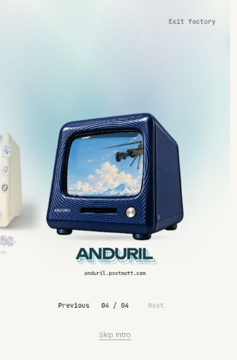

# Computer images

This guide distinguishes production case artwork from screenshots of the separate public prototype. A case image has no live screen content; the app composites the page preview, glass, lighting, and interaction around it.

## Production case art

The main README reuses the existing repository assets directly. No recoloring, new case design, invented UI, or concept render has been substituted.

Verified against [production source commit 18c588b](https://github.com/psstmatt/mattsoft/commit/18c588b5c22fc8546e40675528d522d2eccc78a4) on October 11, 2026:

| Machine         | Repository source                                                                                                                                      | Git blob SHA                               |
| --------------- | ------------------------------------------------------------------------------------------------------------------------------------------------------ | ------------------------------------------ |
| Scout           | [`public/experience/models/scout-inflatable-v1/case.png`](../../public/experience/models/scout-inflatable-v1/case.png)                                 | `1b57316e7e43f0b6d7320253db0877fe13ad0056` |
| References      | [`public/experience/models/references-chrome-baked/frames/case-1-9.webp`](../../public/experience/models/references-chrome-baked/frames/case-1-9.webp) | `b8360667108635bb4de5a5313da5c88bf4211cc3` |
| Anduril / Sonar | [`public/experience/models/anduril-sonar-v2/case.png`](../../public/experience/models/anduril-sonar-v2/case.png)                                       | `65fcf65b63abe7e6d8f6525d5787a03b93597af5` |

Portfolio's green material is applied by the renderer. The underlying ivory case artwork is not a faithful image of the green runtime, so it is not used as a stand-in here.

## Prototype screenshots

The screenshots below are unedited viewport captures of [the public computer prototype](https://matt-konami-computers.psstmatt.chatgpt.site/), **v59**, captured October 11, 2026 (UTC). The corresponding prototype source commit is `4a81fc6de6f71b4a2029aa407a87d7951146a037`.

They show the prototype's factory lighting and navigation, which this release ports into the production application. They are not production deployment screenshots, and they do not show the later angle work or any planned Easter egg. The four desktop captures show each machine after Escape returned from its destination.

| File                                                      | Captured state                                         | Image size |
| --------------------------------------------------------- | ------------------------------------------------------ | ---------- |
| [Portfolio](factory-v59-portfolio-return-desktop.jpg)     | Green runtime material, dark theme, Portfolio selected | 1181 × 757 |
| [Scout](factory-v59-scout-return-desktop.jpg)             | Inflatable orange case, dark theme, Scout selected     | 1181 × 757 |
| [References](factory-v59-references-return-desktop.jpg)   | Sticker case, dark theme, References selected          | 1181 × 757 |
| [Anduril / Sonar](factory-v59-anduril-return-desktop.jpg) | Navy case, dark theme, Anduril selected                | 1181 × 757 |
| [Narrow Sonar](factory-v59-anduril-light-400.jpg)         | Light theme, Anduril selected                          | 400 × 606  |

### Narrow light-theme view

This is a **400-pixel-wide desktop browser viewport**, not a physical-phone screenshot or evidence of real-device touch testing.

## Screenshot policy

Screenshots should name the captured site and version, the date, and the state shown. Prototype screenshots must remain labeled as prototype screenshots, even when their reviewed appearance is subsequently ported to production. The prototype's return from local external-destination captures does not establish working Escape return from the live destination sites.

Angle studies and proposed Easter eggs must be labeled as studies or plans until the corresponding behavior is implemented and verified. The v60 prototype's 19 × 3 Scout/Sonar views, included in this release, use calibrated, image-based 2.5D relief with static source lighting; they do not establish a complete PBR model.
